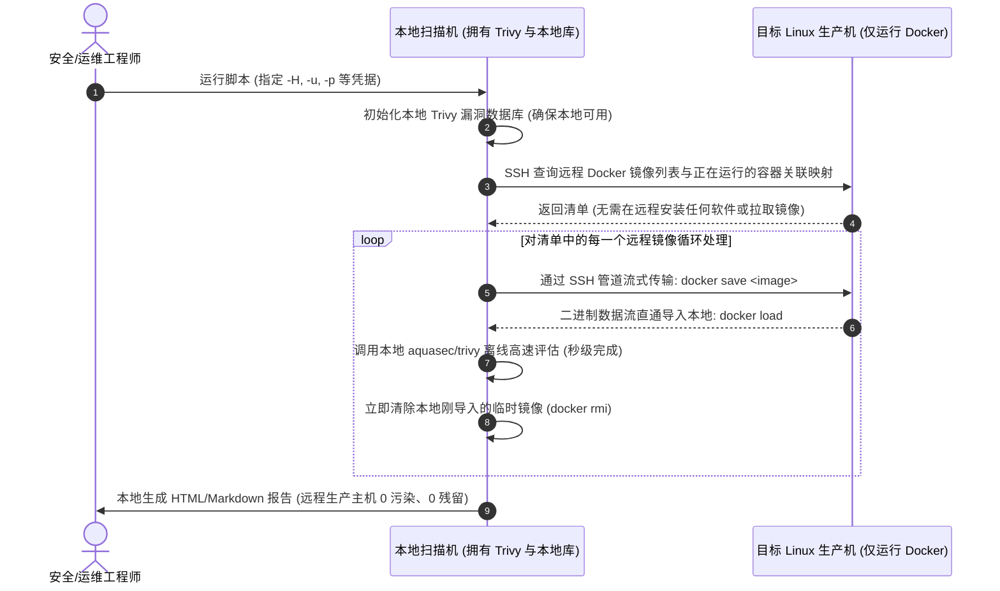

# 🛡️ Docker 容器安全性评估工具 (基于 aquasec/trivy)

本项目提供了一个生产级的 Shell 自动化脚本 `docker-trivy-audit.sh`，直接利用现有的 `aquasec/trivy` Docker 镜像，对**本地或远程 Linux 目标主机**上的所有容器与镜像进行一键式安全审计，并生成结构化的 Markdown 报告与高颜值的交互式 HTML 仪表盘。

---

## ✨ 核心特性

- 🧙 **智能交互式配置向导**：
  - 直接运行脚本即可唤起任务向导，支持选择 Trivy 镜像源（默认国内 DaoCloud 稳定加速源，亦可自选官方或私有源），显示当前本地漏洞库与 Java jar DB 的日期版本，支持一键回车沿用推荐默认值。
  - 支持全自动/CI-CD 静默模式（`-y` / `--non-interactive`）与强制向导模式（`-i` / `--interactive`）。
- 🚀 **全面支持第三方镜像源与自动容灾**：
  - 默认采用国内加速镜像 `docker.m.daocloud.io/aquasec/trivy:latest`，彻底解决国内网络无法直连拉取 Docker Hub 官方镜像的问题。
  - 支持传入任意第三方源（如 DaoCloud、DockerProxy、私有 Harbor 等），且具备**智能回退机制**（若官方源拉取超时失败，自动无缝切换至国内加速源重试）。
- 🌐 **双模评估（本地 / 远程主机 SSH 无代理模式）**：
  - **本地评估**：直接在当前宿主机上完成镜像与关联业务容器的安全审计。
  - **远程主机评估（本地引擎架构）**：
    - **完全使用本地的 `aquasec/trivy` 容器与本地漏洞库**，目标远程主机**无需**安装或拉取 Trivy，**无需**外网下载数据库，**不留下任何临时脚本**！
    - **镜像获取双模式可选**：
      - 📦 **远程计算机复制镜像 (`copy`，默认)**：直接通过 SSH 管道将远程主机的镜像流式导出并导入本地 Docker（`docker save` | `docker load`），**直接从远程计算机复制到本地，绝不从 Docker 源网络下载**，支持隔离局域网环境与自建定制镜像。
      - 🌐 **Docker 源下载镜像 (`pull`)**：本地直接通过网络从 Docker 镜像源（`docker pull`）拉取同名镜像进行评估。
    - **临时镜像智能清理**：默认在评估完成后自动清除本地流式拉取的临时镜像（支持 `--cleanup` / `--no-cleanup` 开关），彻底杜绝本地磁盘被临时镜像占满。
- ⚡ **零重复网络下载 & Java jar 依赖支持**：
  - 启动阶段自动检测主 CVE 漏洞库与 Java jar 依赖库版本，默认离线复用本地缓存。
  - 镜像扫描阶段 100% 离线比对，强制加上 `--image-src docker`、`--skip-db-update`、`--skip-java-db-update` 及 `--offline-scan`，彻底避免网络重试与超时卡顿。
- 🎯 **聚焦活跃业务资产**：
  - 默认聚焦于**正在运行中的业务容器镜像**（`--scope running`），大幅缩减全量无效冷备镜像的耗时；亦可一键切换为全量镜像扫描（`--scope all`）。
- 🔗 **业务容器主动关联**：自动探测并标明发现漏洞的镜像正被哪些活跃业务容器所引用（无论是本地还是远程主机）。
- 🛡️ **多维度安全评估**：
  - **组件与系统漏洞 (`vuln`)**：检测 OS 系统软件包（Debian, Alpine, RedHat 等）及应用程序语言依赖（Node.js, Python, Java, Go, Rust 等）的 CVE 漏洞。
  - **硬编码敏感信息泄露 (`secret`)**：自动发现镜像打包时残留的密码、API Key、Token、私钥等凭据。
- 📊 **全格式报告与任务简报输出**：
  - 📋 **全任务即时简报 (`task_brief.txt` & `task_brief.md`)**：每个任务完成后自动在任务输出目录生成！汇总任务耗时、资产盘点、综合安全定级、Top 重点关注风险资产（附关联在线业务容器与处置优先级）及针对性整改指引，专为终端快速阅读与 CI/CD 消息通知设计。
  - 🖥️ **交互式 HTML 仪表盘 (`index.html`)**：统计大屏、关键字即时搜索、风险过滤与一键查看详情。
  - 📝 **结构化 Markdown 详报 (`summary.md`)**：清晰汇总表格与统计数据，可直接用于 CI/CD、工单或安全汇报。
  - 📄 **原始细粒度报告 (`raw_txt/` & `raw_json/`)**：包含每一款镜像的完整 Trivy CLI 输出与 JSON 数据。

---

## 🏗️ 远程评估执行架构



---

## 🚀 快速上手

### 1. 赋予执行权限
```bash
chmod +x docker-trivy-audit.sh
```

---

### 2. 交互式向导快速启动 (新手推荐)

直接运行脚本，脚本将自动检测终端交互并呈现 5 步向导，按回车即可使用推荐默认值：

```bash
./docker-trivy-audit.sh
```

向导将依次确认：
- **[引擎] Trivy 镜像来源**：默认 `1` 国内加速源（`docker.m.daocloud.io/aquasec/trivy:latest`，回车即可），亦可选 `2` 官方源或 `3` 自定义第三方源。
- **[1/5] 更新主漏洞数据库**：显示当前本地库日期版本，按回车默认 `N`（复用本地缓存）。
- **[2/5] 更新 Java jar DB**：显示当前 Java 依赖库日期版本，按回车默认 `N`（跳过下载）。
- **[3/5] 评估目标环境**：选择 `1` 本地宿主机 或 `2` 远程主机（若选 2，则进一步提示输入主机名/端口/用户名/隐蔽密码，并选择镜像获取方式：`1` 远程计算机复制镜像 或 `2` Docker 源下载镜像）。
- **[4/5] 镜像扫描范围**：选择 `1` 仅运行镜像（默认）或 `2` 全部镜像。
- **[5/5] 远程临时镜像清理**：若选远程模式，默认 `Y`（自动清除本地临时拉取的镜像，释放磁盘）。

---

### 3. 命令行静默/快速模式 (适合 CI/CD 与自动化脚本)

若需在脚本或 CI/CD 流水线中静默执行，传入 `-y` 或 `--non-interactive` 即可跳过所有询问向导：

#### 场景 1: 本地静默极速扫描（仅扫描运行中业务容器）
```bash
./docker-trivy-audit.sh -y
```

#### 场景 2: 远程主机评估 (直接从远程计算机复制镜像 - 默认推荐)
```bash
# 默认使用 --copy-remote-image，直接从远程主机流式复制，不消耗 Docker 源网络
./docker-trivy-audit.sh -y -H 192.168.1.100 -u root -p 'YourPassword123' --copy-remote-image
```

#### 场景 3: 远程主机评估 (从 Docker 源下载镜像)
```bash
# 本地直接通过网络从 Docker 镜像源拉取目标镜像进行评估
./docker-trivy-audit.sh -y -H 192.168.1.100 -u root -p 'YourPassword123' --pull-from-registry
```

#### 场景 4: 远程主机安全交互输入密码（避免密码留在终端历史中）
```bash
./docker-trivy-audit.sh -H 192.168.1.100 -u root
```

#### 场景 5: 全量扫描 + 启用 Java jar 深度依赖比对
```bash
./docker-trivy-audit.sh -y --scope all --update-java-db
```

#### 场景 6: 指定使用第三方加速源或私有源镜像
```bash
# 采用 DaoCloud 加速镜像 (支持国内直连秒级拉取)
./docker-trivy-audit.sh -t docker.m.daocloud.io/aquasec/trivy:latest

# 或使用快捷标志参数 --mirror
./docker-trivy-audit.sh --mirror
```

#### 场景 7: 仅关注严重 (CRITICAL) 与高危 (HIGH) 漏洞
```bash
./docker-trivy-audit.sh -y -H 192.168.1.100 -u root -p 'YourPassword123' --severity CRITICAL,HIGH
```

---

### 4. 远程登录诊断与私有源认证自动同步

针对生产环境中复杂的网络拓扑、账号权限以及企业私有镜像仓库环境，脚本提供了深度支持：

#### 🔍 远程登录智能错误诊断
当远程 SSH 连接或 Docker 服务通信失败时，脚本自动捕获底层错误并进行针对性原因诊断与修复指引：
- **身份认证失败 (`Permission denied`)**：自动诊断为用户名、密码或 SSH 私钥错误，提示排查远程 `sshd` 密码登录策略。
- **连接被拒绝 (`Connection refused`)**：提示远程端口错误或 `sshd` 守护进程未启动。
- **网络连接超时 (`Connection timed out`)**：提示排查网络路由、VPN 隧道与防火墙端口放行规则。
- **Docker 权限不足与提权失败**：仅在直接访问受限且无法通过登录密码 sudo 提权时，提示用户组配置建议。
- **Docker 守护进程未启动 (`Cannot connect to daemon`)**：提示在远程主机执行 `sudo systemctl start docker`。

#### 🛡️ 登录凭据智能提权 (仅在权限不足时提升权限)
针对使用普通运维账号（如 `osadmin`）登录，且该用户未加入 `docker` 用户组导致访问 `/var/run/docker.sock` 受限的场景：
1. **优先直连（零提权开销）**：首先使用当前普通用户权限探测，若可正常操作 Docker 则直接执行，绝不额外调用 `sudo`。
2. **凭据自动提权**：若检测到 `permission denied` 权限不足，脚本自动使用已有登录凭据进行提权尝试：
   - 优先尝试免密提权：`sudo -n docker ...`
   - 若需密码，自动复用 SSH 登录密码通过 `sudo -S` 无缝提权。
3. **透明包装执行**：提权成功后，远程镜像发现（`docker ps`/`inspect`）与二进制流式导出（`docker save`）均自动注入提权包装函数，无需人工手动登机配置权限。

#### 🔑 远程私有 Docker 源认证自动同步
针对部署了私有镜像仓库（如 Harbor、阿里云 ACR、腾讯云 TCR、自建 Registry 等）的场景：
1. **自动探测**：远程建立连接后，脚本自动探测远程用户的 `~/.docker/config.json` 或 `/root/.docker/config.json`。
2. **凭据合并**：提取远程私有仓库 `auths` 凭据，自动合并至本地 Docker 配置（本地原配置自动备份为 `.bak`，绝不丢失）。
3. **容器挂载**：Trivy 扫描容器自动挂载凭据文件（`-v ...:/root/.docker/config.json:ro`），使安全比对完全具备私有源鉴权能力。
4. **离线双轨**：优先通过远程二进制数据流（`docker save` | `docker load`）传输；若遇特殊格式异常，本地 Docker 可直接借助同步的凭据无缝拉取。

---

## ⚙️ 命令行参数全览

| 参数分类 | 参数项 | 长参数 | 默认值 | 说明 |
| :--- | :--- | :--- | :--- | :--- |
| **向导控制** | `-y` | `--non-interactive`, `--batch` | `false` | 静默模式：禁用启动向导，直接按命令行参数执行 |
| | `-i` | `--interactive` | `false` | 强制向导模式：强制开启交互式启动向导 |
| **远程 SSH** | `-H` | `--host` | - | **远程 Linux 目标主机 IP 或域名**（指定此项即启用远程模式） |
| | `-P` | `--remote-port` | `22` | 远程 SSH 端口 |
| | `-u` | `--user` | `root` | 远程 SSH 登录用户名 |
| | `-p` | `--password` | - | 远程 SSH 登录密码（若不传且无私钥，将交互式安全提示输入） |
| | `-k` | `--key` | - | 远程 SSH 私钥路径（与密码二选一） |
| | | `--cleanup` / `--no-cleanup` | `--cleanup` | 远程模式下是否在评估后自动清理本地流式拉取的临时镜像 |
| | | `--image-transfer-mode` | `copy` | 远程镜像获取方式：`copy` (远程计算机复制镜像) 或 `pull` (Docker 源下载镜像) |
| | | `--copy-remote-image` | 默认 | 快捷选择：直接从远程计算机复制镜像到本地 (SSH 流式，不经 Docker 源) |
| | | `--pull-from-registry` | - | 快捷选择：本地通过网络从 Docker 镜像源直接拉取 (docker pull) |
| | | `--remote-docker-config` | 自动探测 | 指定远程 Docker 配置文件路径（默认自动探测 `~/.docker/config.json` 或 `/root/.docker/config.json`） |
| | | `--no-sync-docker-auth` | `false` | 禁用远程 Docker 镜像源认证凭据自动同步 |
| **通用评估** | `-s` | `--scope` | `running` | 扫描范围：`running` (仅正在运行的业务容器镜像，推荐) 或 `all` (宿主机全部镜像) |
| | `-l` | `--severity` | `CRITICAL,HIGH,MEDIUM,LOW` | 漏洞严重程度过滤，多个以逗号分隔，可选 `CRITICAL,HIGH,MEDIUM,LOW,UNKNOWN` |
| | | `--scanners` | `vuln,secret` | 启用的检测模块：`vuln` (软件依赖漏洞), `secret` (敏感密钥泄露) |
| | `-o` | `--output-dir` | `./trivy-audit-reports` | 报告存储的根目录 |
| | `-t` | `--trivy-image`| `docker.m.daocloud.io/aquasec/trivy:latest` | 使用的 Trivy Docker 镜像（支持第三方加速源与私有源） |
| | | `--mirror` | - | 快速切换为国内加速镜像源 (`docker.m.daocloud.io/aquasec/trivy:latest`) |
| | | `--official` | - | 切换为 Docker Hub 官方镜像源 (`aquasec/trivy:latest`) |
| | `-c` | `--cache-dir` | `~/.cache/trivy` | 宿主机漏洞数据库本地缓存目录 |
| | | `--db-repository` | `ghcr.io/aquasecurity/trivy-db:2` | 自定义漏洞数据库 OCI 仓库地址 |
| | | `--skip-db-update` | `true` (交互默认) | 跳过向官方拉取最新漏洞库（内网隔离环境或复用本地缓存） |
| | | `--update-java-db` | `false` | 联网更新 Trivy Java (jar) 依赖数据库 |
| | | `--skip-java-db-update` | `true` | 跳过 Java jar 数据库更新 |
| | | `--java-db-repository` | `ghcr.io/aquasecurity/trivy-java-db:1` | 自定义 Java 依赖数据库 OCI 仓库地址 |
| | | `--timeout` | `15m` | 单个镜像扫描的超时上限 |
| | `-d` | `--debug` | `false` | 开启调试模式，实时输出 Trivy 底层运行日志 |
| | `-h` | `--help` | - | 显示帮助菜单与常用示例 |

---

## 📂 生成的报告目录结构

执行完成后，无论是本地还是远程模式，脚本都会将最终报告规整存放在本地输出目录下：

```text
trivy-audit-reports/remote_192.168.1.100_20261028_143000/
├── task_brief.txt            # 📋 任务简报 (纯文本版，适合终端直接 cat 或发送消息机器人/邮件)
├── task_brief.md             # 📝 任务简报 (Markdown 版，含综合评级、Top高危资产与整改指南)
├── index.html                # 🌟 交互式 Web 可视化仪表盘 (用浏览器直接打开即可查看)
├── summary.md                # 📊 Markdown 综合评估详报
├── summary_data.js           # 仪表盘所用的统计指标数据源
├── remote_docker_config.json # 🔑 同步的远程 Docker 私有源认证配置副本 (远程模式特有)
├── raw_json/                 # 每一个镜像的原始结构化 JSON 数据文件
│   └── nginx_alpine.json
└── raw_txt/                  # 每一个镜像的易读表格文本日志
    └── nginx_alpine.txt
```
